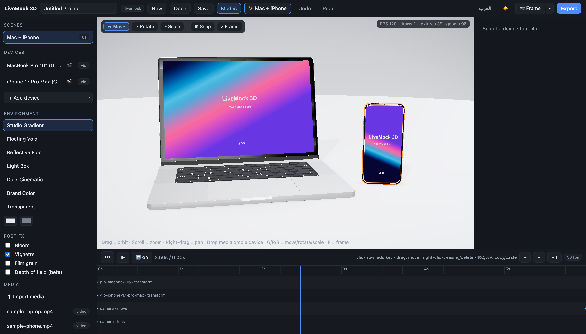
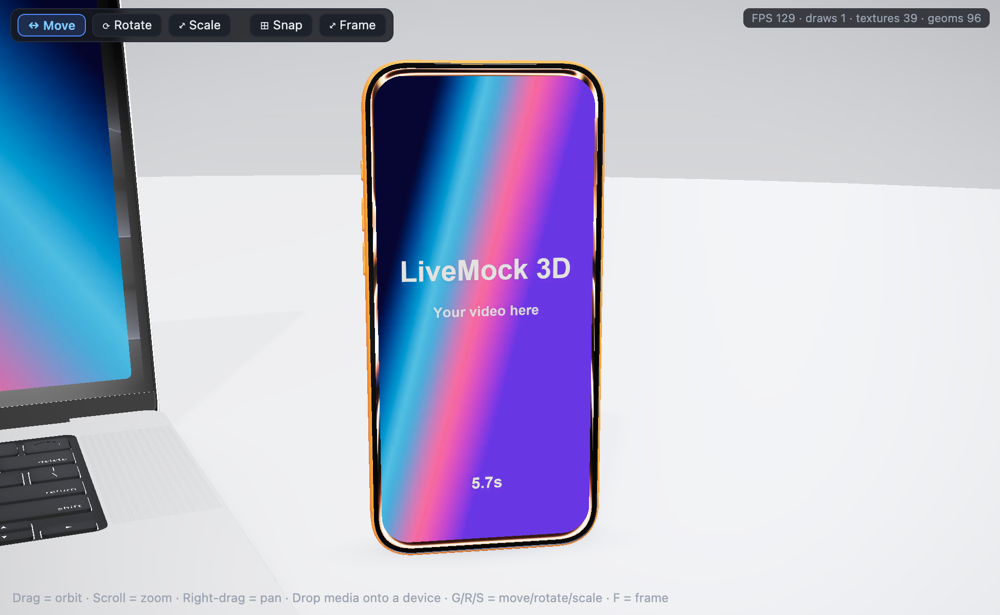
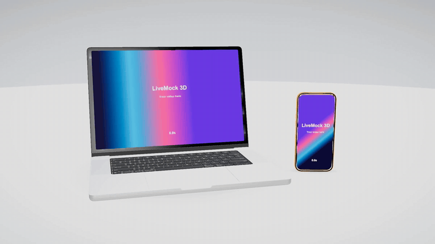
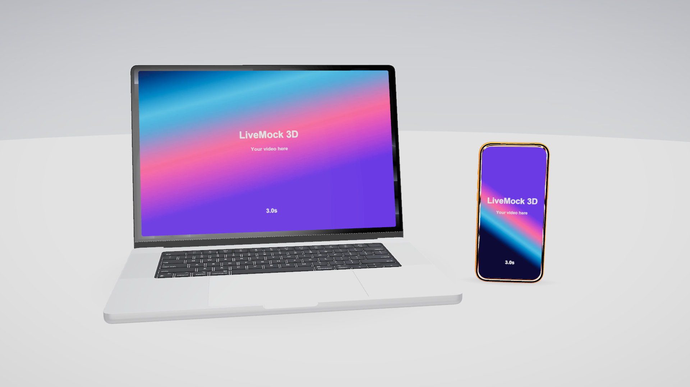
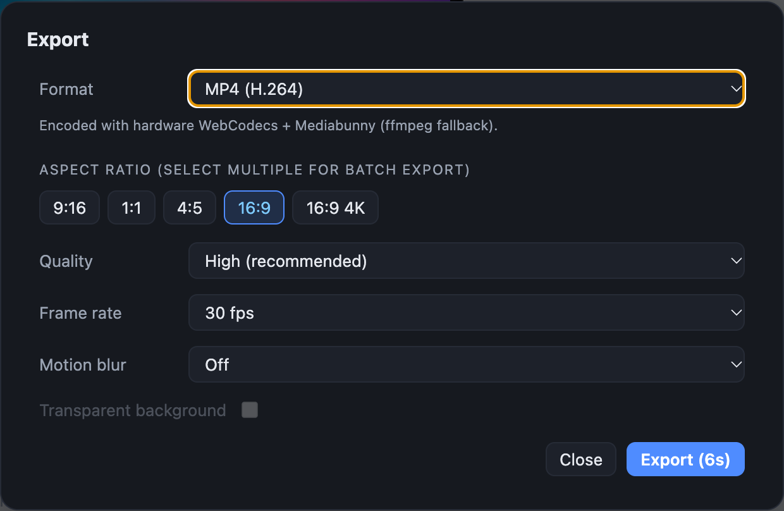
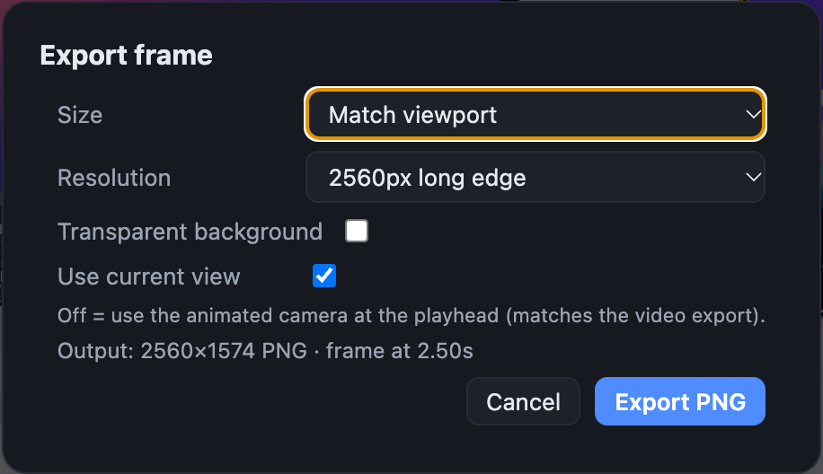
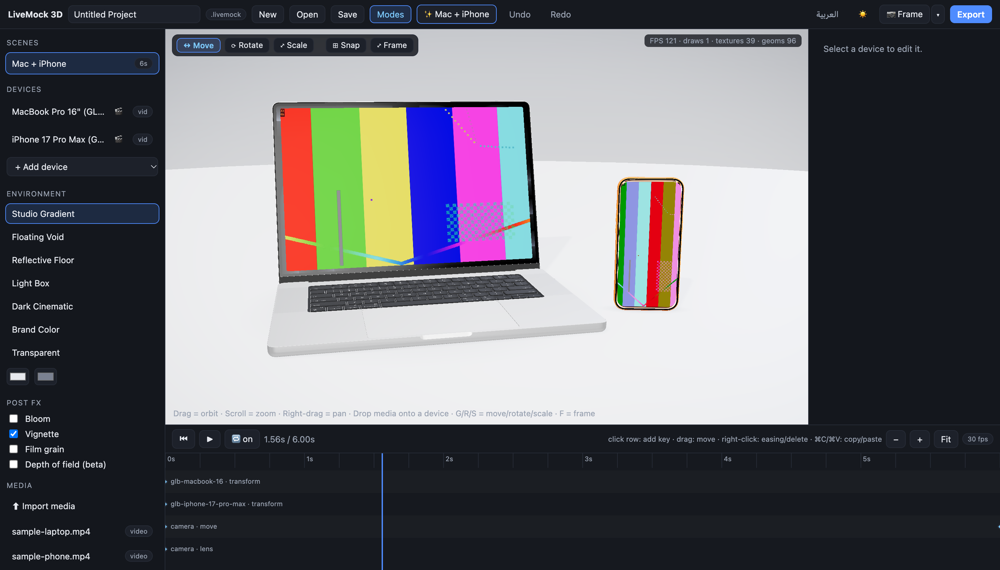
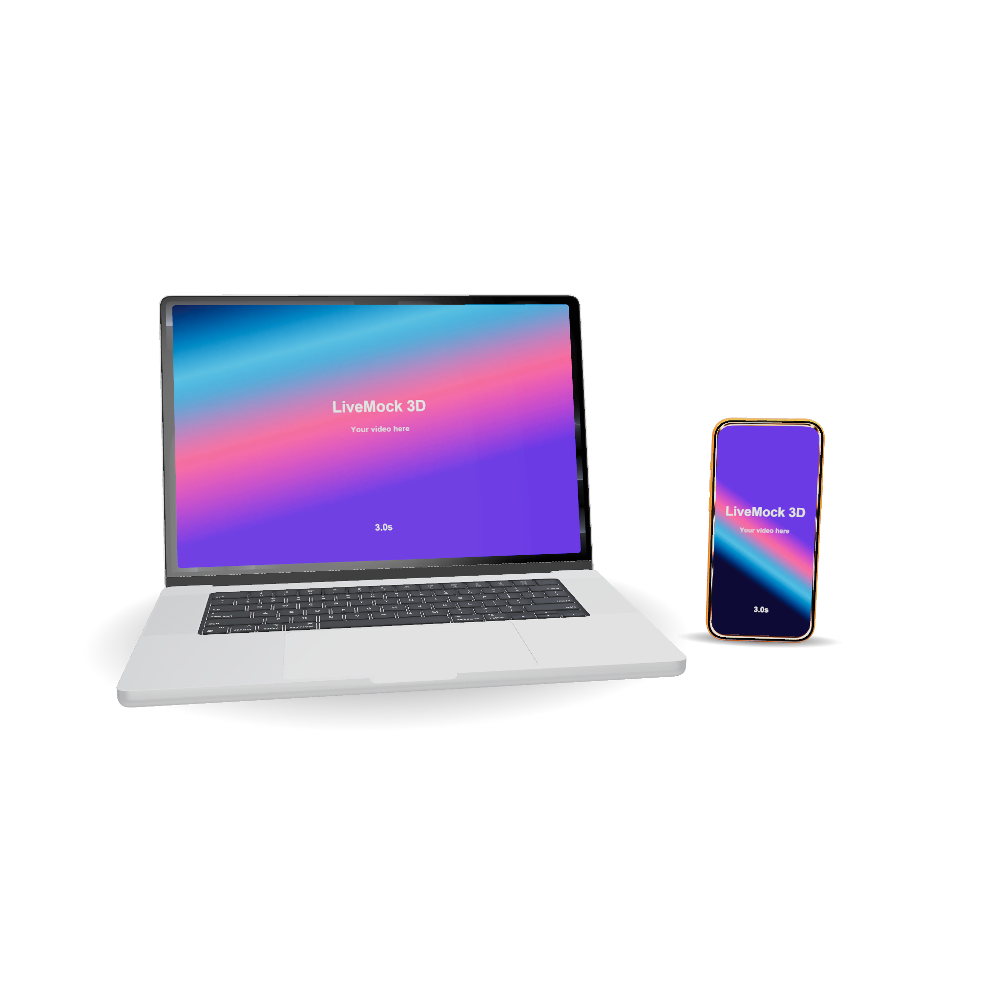
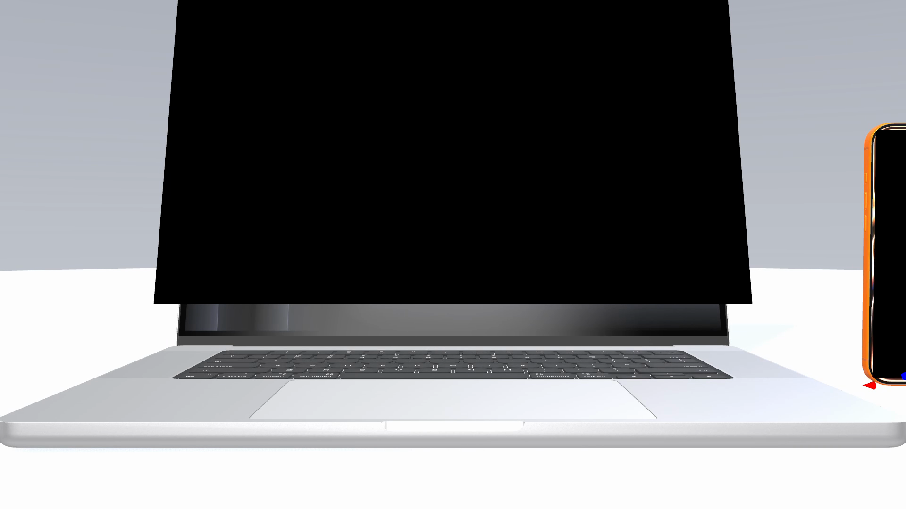

# LiveMock 3D

**Put any screen content on a 3D phone, laptop, tablet or monitor, animate it
cinematically, and export a ready-to-edit video or a high-res still in
minutes. Free and open source (MIT): no accounts, watermarks or telemetry.**

Electron + Three.js desktop app for macOS and Windows. Everything runs locally.

## What it does (in simple words)

LiveMock 3D puts your app or website onto a realistic 3D phone or laptop. You
drop in a screen recording, video or image and it plays on the device's
screen. A camera move (slow push-in, spin, tilt…) makes it look like a
product ad. Then you save a video (MP4 and more) or a high-quality picture
(PNG) to use on social media, a landing page or in a pitch.

### Make your first video

1. **Add a device:** pick one from *+ Add device*, or click **✨ Mac + iPhone**
   for a MacBook and an iPhone together.
2. **Drop your video on the screen:** drag the file from Finder/Explorer onto
   the device (or click **🎬** next to it in the Devices list).
3. **Pick a camera move:** click **Modes** and choose one (e.g. Cinematic
   Hero), then press ▶ to preview.
4. **Export:** click **Export** for a video or **📷 Frame** for a PNG. Files go
   to `~/Downloads/LiveMock/`.

## Screenshots


*The editor: Mac + iPhone scene loaded, with the device list and environments
on the left and the timeline at the bottom.*


*Your video plays live on the device screen (here the sample clip on the
iPhone 17 Pro Max, with rounded screen corners).*


*A preview of an exported video (GIF made from
[`demo/sample-video-1920x1080.mp4`](demo/sample-video-1920x1080.mp4)): slow
camera push-in, both screens playing.*


*A sample exported frame: a 1920×1080 PNG made with 📷 Frame.*

| Video export dialog | Frame (PNG) export dialog |
|---|---|
|  |  |
| *Pick format, aspect ratios (several at once), quality, fps, motion blur.* | *Pick size, transparent background, and current view vs. animated camera.* |

| Your own clips on both screens | Transparent PNG |
|---|---|
|  |  |
| *Any video you drop fills its screen, cropped to fit.* | *Background removed for compositing, with soft shadows kept.* |

| Before this update | After |
|---|---|
|  |  |
| *Old export: black screens, the MacBook screen floating off the lid, editor arrows baked in.* | *Now: correct screen placement, video playing, clean framing.* |

More outputs: [`demo/sample-frame-viewport.png`](demo/sample-frame-viewport.png),
[`demo/e2e-report.json`](demo/e2e-report.json) (automated checks).

## Features

- **Frames (PNG):** one click (📷 Frame, ⌘⇧F) exports exactly what the
  viewport shows. Options: match viewport up to 5120 px, 16:9 1080p/4K, 9:16,
  1:1, 4:5, 3:2; transparent background; current view or the animated camera
  at the playhead.
- **Video export:** MP4 H.264 / HEVC (hardware WebCodecs + Mediabunny, ffmpeg
  fallback), MOV ProRes 4444 with alpha, WebM VP9 with alpha, GIF, PNG
  sequence. Batch several aspect ratios (9:16, 1:1, 4:5, 16:9, 4K) in one go,
  motion blur, quality presets, progress/ETA/cancel, and a post-export check
  of resolution, fps and duration. Rendering is deterministic: video
  screens are decoded frame-exactly, never by `<video>` seeking.
- **Devices:** procedural phones (6.9", 6.3", Android 6.7"), tablets (11",
  13"), laptops (14", 16") and a 27" monitor, plus GLB presets for
  **iPhone 17 Pro Max** and **MacBook Pro 16"** (your own model files; see
  below) and custom `.glb` import. Finishes/colors, glare, cutouts, an
  animatable laptop lid and soft contact shadows.
- **Screen content:** your **videos** (loop, speed, trim in/out, fill / fit /
  crop) and **images**, **live websites** rendered in real Chromium (so
  Arabic/RTL text renders correctly) with walkthroughs and Record Take, and
  **screen/window mirror**.
- **Camera + timeline:** keyframe tracks with easing/bezier, undo/redo, and
  one-click camera modes: Cinematic Hero, Spin Reveal, Float & Tilt, Zoom
  Detail, Auto Walkthrough, Device Flip, Side by Side, Carousel, Laptop Open.
- **Look:** 7 environments (studio gradient, floating void, reflective floor,
  light box, dark cinematic, brand color, transparent), bloom, vignette and
  film grain.
- **✨ Mac + iPhone showcase:** a ready-made scene with both devices, a sample
  clip on each screen and a hero push-in. Swap in your own clips and export.
- English/Arabic UI with RTL, light/dark theme, `.livemock` project files,
  autosave + crash recovery.

## Quick start

Requires Node 22+.

```bash
npm install
npm run dev        # launch in dev mode (or: npm run build && npm start)
```

Then click **✨ Mac + iPhone** in the top bar, press ▶, and use **📷 Frame**
or **Export**. Outputs go to `~/Downloads/LiveMock/`.

```bash
npm run typecheck  # strict TS across main + renderer
npm test           # unit tests (vitest)
npm run build && node tests/e2e-flows.mjs demo   # drives the built app through frames/video/devices/insert flows
npm run dist       # platform packages via electron-builder
```

## Put a video (or image) on a device screen

Use any of these:

1. **Drag a file from Finder/Explorer onto a device** in the viewport. A drop
   hint shows which device will receive it.
2. **Drop it on the device's row** in the left panel's *Devices* list.
3. Click the **🎬** button on a device row and pick a file.
4. Select the device, then in the inspector choose *Screen content → Video*
   (or *Image*).
5. Drag an item from the *Media* list onto a device (double-click puts it
   on the selected device).

Videos play in the preview and are decoded frame-exactly in exports. The
default fit is **Crop**, which fills the screen. **Fit** letterboxes to show
the whole frame, and **Fill** stretches. Loop, speed, trim in and trim out are
in the inspector. Supported files: mp4, mov, m4v, webm, png, jpg, webp, gif.

## Export guide

| Want | Use | Notes |
|---|---|---|
| A still of what you see | **📷 Frame** (⌘⇧F) | Uses the remembered settings. Set them with **▾** |
| A still with no background | ▾ → *Transparent background* | Alpha PNG; floor/backdrop hidden, contact shadows kept |
| Social video | **Export** → MP4 (H.264) | Pick one or more aspects; HEVC for smaller files |
| Video with alpha for editing | **Export** → ProRes 4444 or WebM VP9 | Tick *Transparent background* |
| Frames for compositing | **Export** → PNG sequence | Numbered files |
| Quick preview loop | **Export** → GIF | |

Exports render the animated camera track. A narrower output (e.g. 9:16 from a
wide scene) keeps everything visible left-to-right in the editor, so reframe
the camera for a tighter vertical shot. *Live URL* screens need a recorded
**take** (Record Take in the inspector) before video export.

## Your own GLB device models

Device models are **not** included in this repository (trademarks). To use
the GLB presets, put the files in `assets/models/` (gitignored):

| File | Preset |
|---|---|
| `phone_17_pro_max.glb` | iPhone 17 Pro Max (GLB) |
| `macbook_pro_m3_16_inch_2024.glb` | MacBook Pro 16" (GLB) |

They appear in **Add device** and the showcase uses them automatically. The
showcase falls back to the built-in devices if they're missing. Any other
`.glb` can be imported per device from the inspector (*Custom GLB*).

How a model's screen is found: a mesh named `Screen`/`Display` wins;
otherwise the self-lit (emissive-mapped) display mesh; otherwise the largest
flat mesh. Models are normalized to real-world millimetres and grounded. The
screen content goes on a quad that follows the display's true orientation
and sits just in front of the bezel, measured from real vertices. Laptop
lids get a hinge pivot. Presets can set `screenCornerRadiusMm` for rounded
displays (`src/shared/presets.ts`).

## Project structure

```
src/
  main/          Electron main: window, typed IPC handlers, media protocol
                 (Range-aware), workspace/projects, offscreen live pages,
                 takes, ffmpeg export + verification
  preload/       contextBridge API (the only renderer ↔ main surface)
  shared/        types, presets, IPC contracts, pure export/easing/serialize helpers
  renderer/src/
    engine/      Three.js scene controller (view.ts), devices + GLB loader,
                 environments, post FX, screen sources (image/video/live)
    export/      deterministic exporter (WebCodecs/Mediabunny, ffmpeg, PNG still),
                 frame-exact video decode
    ui/          top bar, panels, inspector, timeline, export + frame dialogs,
                 showcase, first run
    state/       store with undo/redo
    i18n/        en / ar strings
assets/          sample-media (showcase clips), test-pages (offline EN/AR demo),
                 models (your GLBs, gitignored)
tests/           unit tests (vitest) + Playwright-Electron e2e/probe scripts
                 (capture-readme.mjs regenerates docs/screenshots)
demo/            before/after screenshots and sample exports
docs/            README screenshots + development screenshots from earlier milestones
```

Security: every window is sandboxed (`sandbox`, `contextIsolation`, no
`nodeIntegration`) and has a strict CSP. All IPC channels are declared in
`src/shared/ipc.ts` and validated in main. Sample media is imported by
whitelisted name, never by path.

See `SPEC.md` (product spec), `PLAN.md` (milestones) and `CHANGELOG.md`.

## Credits & licensing

- Code: **MIT** (see `LICENSE`).
- ffmpeg is bundled via `ffmpeg-static` (GPL builds, used as a separate process).
- Three.js, Mediabunny and fflate are MIT.
- The sample clips in `assets/sample-media` were generated with ffmpeg for
  this project.
- Device GLB models are user-supplied and not distributed. Apple, iPhone and
  MacBook are trademarks of Apple Inc. This project is not affiliated with
  Apple. See `CREDITS.md`.
